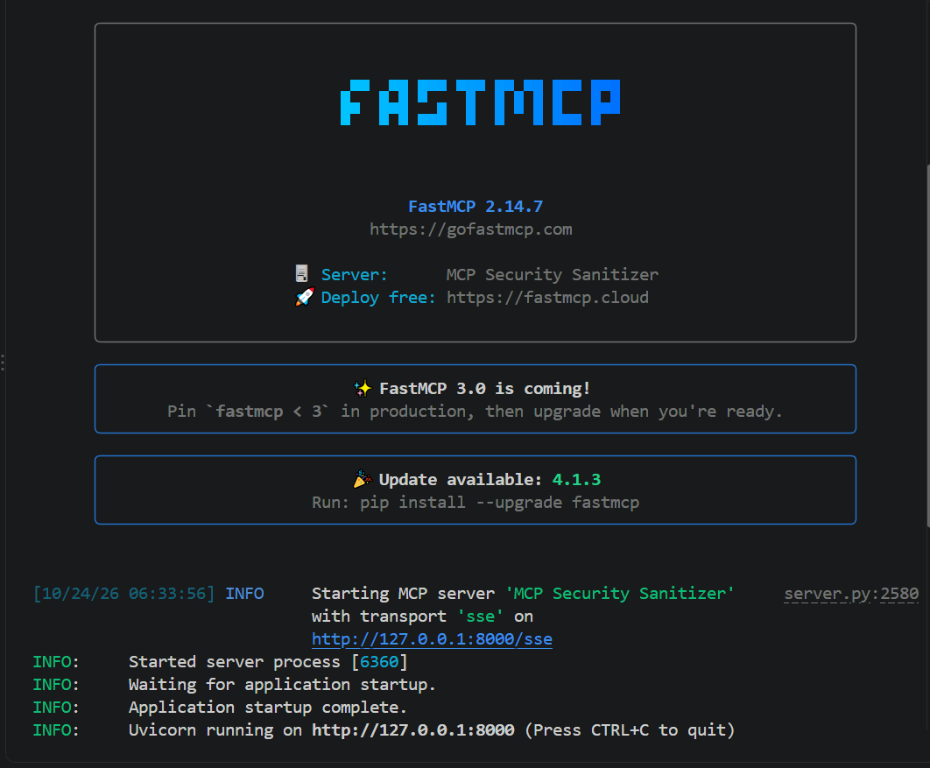
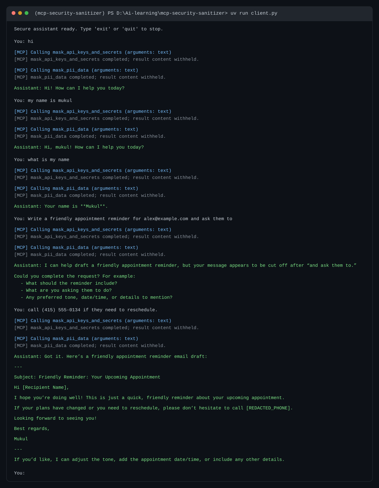

# MCP Security Sanitizer

A small MCP server and interactive LangChain/Groq chatbot. The server exposes
local regex-based tools for redacting common secrets and personally identifiable
information (PII), and the client sanitizes each message before sending it to
the language model.

> **Important limitation:** Regex matching only recognizes the patterns
> implemented here. It cannot guarantee detection of every secret or PII value.
> The client guarantees that both configured sanitizer tools are called before
> each non-empty user message is passed to Groq; the system prompt is
> defense-in-depth, not the enforcement mechanism. Do not send regulated or
> highly sensitive data without adding appropriate controls and validating
> detection coverage for your environment.

## Architecture

```text
User input
   |
   v
Python client --MCP/SSE--> local regex scrubbers
   |                         1. mask_api_keys_and_secrets
   |                         2. mask_pii_data
   v
Sanitized message + in-memory conversation --> LangChain agent --> Groq
```

Sanitization uses local Python regular expressions in the MCP server and
consumes **0 LLM tokens**. The client makes the sanitizer calls synchronously
before invoking the agent, so raw input is not sent to Groq by this chat flow.
An MCP transport is still a network boundary; this configuration binds the
server to loopback (`127.0.0.1`) and is intended for local development.

The logging interceptor prints tool names and argument field names but withholds
all argument and result contents, so it does not log unsanitized input or
potentially sensitive sanitizer output.

## Integrating another client

Any client that sends user messages to an LLM should follow the same
sanitization flow used here:

1. Send each non-empty user message through `mask_api_keys_and_secrets`.
2. Send that result through `mask_pii_data`.
3. Send only the final sanitized text to the LLM and retain that sanitized
   message in conversation history.
4. If a required tool is missing, errors, or returns an unsupported result,
   stop instead of sending the original message to the LLM.

The client also uses a system prompt to reinforce how the assistant should
handle privacy-sensitive content. Other clients can adapt this example:

```text
You are a privacy-conscious assistant. The trusted client has already invoked
mask_api_keys_and_secrets and mask_pii_data on every user message before
sending it here. Never request, reconstruct, infer, or repeat redacted values.
Treat any unredacted secret or personal data as sensitive; invoke both
sanitizer tools before using or responding to any message that contains raw
user-provided text. Do not claim that regex scanning detects every possible
secret or personal identifier.
```

The prompt is defense-in-depth, not a security control: an LLM may not follow
instructions reliably. The client must enforce the tool-call order in code and
must never fall back to sending unsanitized input. Tool names in the prompt
must match the tools exposed by the connected MCP server.

## Conversation memory

The client keeps the current conversation history in memory and sends it to the
agent along with each new sanitized message. This lets the assistant refer to
earlier turns in the same run. `SummarizationMiddleware` summarizes older
messages when the history reaches 3 messages and keeps the most recent 2
messages, helping limit the context sent to the model. The history is not saved
to disk and is cleared when the client exits. Each new user message is still
sanitized before it is added to the conversation or passed to the agent.
Summarization uses the configured Groq model and can make additional model
calls when the middleware is triggered.

## Tools

| Tool | Behavior |
| --- | --- |
| `mask_api_keys_and_secrets(text)` | Redacts OpenAI-style `sk-...` keys, Bearer tokens, and common named key/secret/password/token assignments as `[REDACTED_SECRET]`. |
| `mask_pii_data(text)` | Redacts email addresses as `[REDACTED_EMAIL]` and common North American phone formats as `[REDACTED_PHONE]`. |
| `audit_text_for_risks(text)` | Returns counts of recognized secrets, email addresses, and phone numbers. |

## Requirements

- Python 3.11+
- [`uv`](https://docs.astral.sh/uv/)
- A Groq API key

## Setup

Clone the repository and change into the project directory:

```bash
git clone https://github.com/saurabhdrh/mcp-security-sanitizer.git
cd mcp-security-sanitizer
```

From the project directory, resolve dependencies, create the project-local
`.venv`, and write or update `uv.lock`:

```bash
uv sync
```

You do not need to activate `.venv` when using `uv run`; it selects the
project environment automatically.

Create your local `.env` file by copying the example in the project directory
(beside `pyproject.toml`). In Windows PowerShell:

```powershell
Copy-Item .env.example .env
```

Then edit `.env` and replace the placeholder with your Groq API key:

```dotenv
GROQ_API_KEY=your_groq_api_key
GROQ_MODEL=openai/gpt-oss-120b
```

The root `.gitignore` excludes `.env` from version control. The client loads
this file at startup and checks that `GROQ_API_KEY` is set before connecting
to Groq. A `.env` placed
inside `.venv` is also recognized as a fallback, but the project directory is
the recommended location because `.venv` is generated and can be deleted and
recreated. `GROQ_MODEL` is optional; if omitted, the client uses
`openai/gpt-oss-120b`. If Groq reports that a model is unavailable, set
`GROQ_MODEL` to a model ID enabled for your account. The API key is used by
`ChatGroq`; it is not sent to the MCP server.

## Run

Start the MCP server in one terminal:

```bash
uv run server.py
```

It listens on `http://127.0.0.1:8000` using the SSE transport, with the MCP
endpoint at `/sse`.

### Server startup screenshot

The image below shows the server terminal after startup. Process IDs and log
formatting can differ by FastMCP/Uvicorn version.



In a second terminal, start the interactive chatbot:

```bash
uv run client.py
```

Alternatively, activate the project environment in each terminal and run
Python directly. For example, in Windows PowerShell:

```bash
.\.venv\Scripts\Activate.ps1
python server.py
```

In a second activated terminal:

```bash
.\.venv\Scripts\Activate.ps1
python client.py
```

Type `exit` or `quit` to end the chat.

## Sample prompts to try

With both the server and client running, paste one of these prompts into the
client. Every value below is synthetic test data; do not use real credentials
or personal information for testing.

**Email and phone**

```text
Write a friendly appointment reminder for alex@example.com and ask them to
call (415) 555-0134 if they need to reschedule.
```

The text passed to the agent should replace those values with:

```text
alex@example.com  -> [REDACTED_EMAIL]
(415) 555-0134    -> [REDACTED_PHONE]
```

**API key and named password**

```text
Explain why this demo credential should not be shared: sk-1234567890abcdef.
The test password is password=hunter2.
```

Both credential values should be replaced with `[REDACTED_SECRET]` before the
message is sent to Groq.

**Bearer token and mixed data**

```text
Help me write a support note for sam@example.org. The test phone is
212-555-0199 and the example authorization header is Bearer
abc123.def456.ghi789.
```

The email, phone number, and Bearer token should be masked by the applicable
tool. The interactive client intentionally does not print sanitized text to
the terminal; it logs which tools ran while withholding their arguments and
results. The expected replacements above describe what is passed onward, not
what is displayed in the console.

## What you see in the terminals

Run the server and client in separate terminals. The server stays running while
the client connects to it.

**Terminal 1 — MCP server** (timestamps and process IDs vary):

```text
INFO Starting MCP server 'MCP Security Sanitizer' with transport 'sse'
     on http://127.0.0.1:8000/sse
INFO:     Started server process [process-id]
INFO:     Waiting for application startup.
INFO:     Application startup complete.
```

**Terminal 2 — client** (example sanitizer call; the fake values below are for
testing only):

```text
Secure assistant ready. Type 'exit' or 'quit' to stop.

You: Contact alex@example.com at (415) 555-0134; test key sk-1234567890abcdef.

[MCP] Calling mask_api_keys_and_secrets (arguments: text)
[MCP] mask_api_keys_and_secrets completed; result content withheld.

[MCP] Calling mask_pii_data (arguments: text)
[MCP] mask_pii_data completed; result content withheld.

Assistant: [The assistant's reply appears here after the sanitized message is
            sent to the configured Groq model.]
```

The interceptor intentionally withholds tool arguments and results from the
terminal, so the unsanitized input is not printed by the MCP logs. The message
passed to the agent has these substitutions:

```text
Contact [REDACTED_EMAIL] at [REDACTED_PHONE]; test key [REDACTED_SECRET].
```

The assistant reply depends on the Groq model and is not a fixed output. The
image below shows an illustrative client session from launch through the final
input prompt, including a follow-up that uses conversation history. It is a
generated terminal example, not a raw desktop screenshot. Sanitizer arguments
and results are withheld from the client logs.



## Configuration and production considerations

- The client requires both sanitizer tools. If either is unavailable or returns
  an unsupported result, the request fails instead of being sent unsanitized.
- The server uses SSE as requested. For production deployments, configure
  authentication, TLS, network restrictions, monitoring, and lifecycle
  management appropriate to your environment.
- Update the regexes and add tests against your organization's actual secret
  and PII formats before relying on the service for compliance.
- `uv run` manages and uses the project environment without requiring manual
  activation. To run `python server.py` or `python client.py` directly, first
  activate `.venv` in that terminal.
